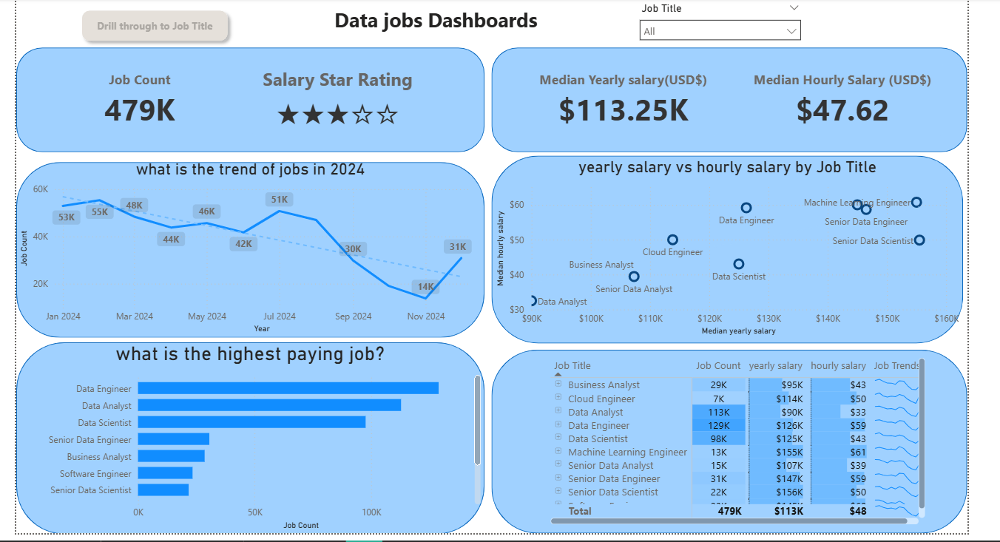
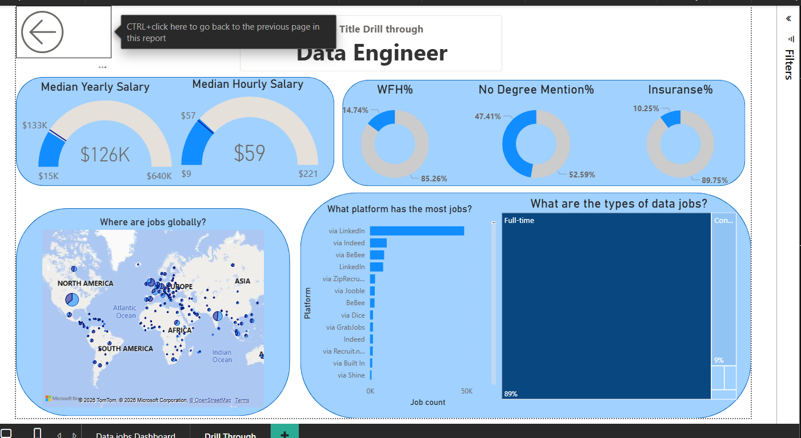

# Data Jobs Dashboard

## Introduction
This interactive dashboard provides a comprehensive overview of the global landscape for data-related professions throughout 2024. By synthesizing market volume, compensation metrics, and hiring requirements, the report offers a data-driven perspective on the health and evolution of the industry.

## Skills Shocased

1. **Data Visualization & UI/UX Design KPI Scorecard Design:**

- Effective use of high-level metrics (Job Count, Median Salary) to provide an immediate executive summary.

- Interactive Navigation: Implementation of Drill-through actions and "Back" navigation, allowing users to move from a macro view to a micro, role-specific analysis.

- Thematic Consistency: A clean, professional blue-themed UI with rounded containers that improve scannability and visual hierarchy.

- Conditional Formatting: The use of "Salary Star Ratings" to translate numerical data into an easily digestible visual rank.

2. **Quantitative Analysis**

- Trend Analysis: Tracking job market fluctuations over time (Jan 2024 – Nov 2024) using line charts and trend lines to identify seasonality.

- Correlation Analysis: Utilizing scatter plots to compare Yearly vs. Hourly salary to identify outliers and high-value roles.

- Geographic Distribution: Use of map visualizations to represent global job density and regional market hubs.

- Distribution & Composition: Implementing Treemaps and Pie charts to show job types (Full-time vs. Contract) and fringe benefits (Insurance%, WFH%).

3. **Business Intelligence & Tool Mastery Data Modeling:**
 
 - Handling multiple variables such as job titles, platforms, locations, and compensation across different dimensions.

- Platform-Specific Metrics: Analyzing which job boards (LinkedIn, Indeed, etc.) are most effective for specific roles.

- Requirement Analysis: Extracting and visualizing non-traditional hiring metrics, such as the percentage of jobs with "No Degree Mentioned."

4. **Strategic Communication Insight Generation:**

 - Transforming raw data into actionable insights for job seekers (e.g., identifying that Machine Learning Engineers have the highest yearly salary).

- Market Benchmarking: Providing a clear comparison of roles like Data Analyst vs. Data Engineer to help with career pathing.

## Dashboard Overview

###  Page 1 : High level Market view

This primary page serves as an executive command center, providing a macro-level view of the data industry. It features high-level scorecards for total job volume (479K) and median compensation benchmarks. Key visualizations include a time-series line chart tracking hiring trends throughout 2024 and a scatter plot correlating yearly vs. hourly pay, allowing users to quickly identify high-growth roles and top-tier salary brackets.

###  Page 2 : Role-Specific Drill-Through

The second page provides a granular deep-dive into individual job titles, such as **Data Engineer**. It shifts focus to the "hidden" details of the market, including geographic density via a global map and a breakdown of recruitment channels like LinkedIn and Indeed. Most importantly, it tracks qualitative workplace metrics, specifically visualizing the prevalence of remote work (WFH%), insurance benefits, and the significant percentage of roles that prioritize skills over traditional degrees.

## Conclusion

Developing this dashboard was a masterclass in interactive UX design and advanced data storytelling. By mastering DAX and complex data modeling, I successfully transformed 479K raw data points into a high-scannability tool that balances technical precision with strategic business insights. This experience refined my ability to bridge the gap between technical execution and executive-level decision-making.